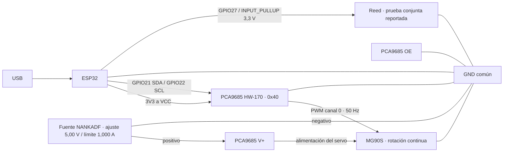

# Issue #51 — Documentar y validar la alimentación del circuito físico

**Estado:** prueba conjunta de reed y servo reportada durante aproximadamente dos minutos sin calentamiento, reinicios ni movimientos inesperados; fotografías del montaje incorporadas. Falta evidenciar la conexión a la fuente externa y confirmar el límite de corriente de la prueba.  
**Actualización documental:** 22 de octubre de 2026.  
**Objetivo:** documentar y validar la alimentación entre fuente, ESP32, PCA9685, sensor y actuador, distinguiendo los resultados registrados de las comprobaciones pendientes.

Esta actualización toma como fuentes el [resumen del montaje y las pruebas](resumen-esp32-pca9685.md), actualizado el 20 de octubre de 2026, y las salidas serie y observaciones de las pruebas del reed y del conjunto comunicadas por el usuario el 22 de octubre de 2026. Las pruebas físicas fueron realizadas por el usuario; actualizar el documento no equivale a ejecutar otra prueba ni verificar instrumentalmente sus resultados.

## Resumen

El montaje registrado separa la alimentación lógica de 3,3 V de la alimentación del servo. La ESP32 se alimenta por USB, se comunica con la PCA9685 por GPIO21/GPIO22 y la detecta en `0x40`. La PCA9685 genera PWM a 50 Hz por el canal 0; el servo recibe energía de la fuente externa a través de `V+`. OE quedó unido a GND.

El servo probado se comportó como uno de **rotación continua**: se movió con pulsos de 1600 y 1800 µs y se detuvo con 1700 µs. Estos valores son observaciones del ejemplar probado, no posiciones angulares ni una especificación aplicable a otros servos.

Se selecciona el reed para esta validación: el usuario confirmó su lectura individual y después el funcionamiento conjunto con el servo durante aproximadamente dos minutos. No observó calentamiento, reinicios ni movimientos inesperados en ese periodo. Confirmó el uso de GPIO27; el sketch utiliza `INPUT_PULLUP` y el contacto hacia GND. El Hall queda fuera de este montaje; requerirá validación eléctrica antes de cualquier uso posterior.

El módulo TC1508A es un controlador para motores DC y **no forma parte del circuito del servo**.

## Inventario identificado

| Componente | Identificación visible | Función / datos conocidos | Estado |
|---|---|---|---|
| Placa de desarrollo | NodeMCU ESP-32S V1.1; módulo blindado marcado ESP-32D; USB-C | Alimentada por USB. GPIO de lógica 3,3 V. Firmware registrado con `Wire.begin(21, 22)`. | Comunicación I²C con la PCA9685 registrada. |
| Controlador PWM | PCA9685, placa HW-170, 16 canales, 12 bits, I²C | VCC conectado a 3V3; V+ separado para el servo. Serigrafía: V+ máximo 6 V. Dirección encontrada: `0x40`; PWM de prueba: 50 Hz, canal 0. | Detección I²C y control del servo registrados; la serigrafía no certifica la capacidad de corriente del módulo. |
| Actuador | Microservo etiquetado MG90S | Ejemplar de rotación continua según la prueba. Alimentado desde V+ externo; señal, positivo y tierra conectados al canal 0. | Movimiento y parada registrados; ficha exacta y consumo bajo carga pendientes. |
| Sensor magnético | Módulo HW-477 V0.2, probablemente tipo Hall digital | La placa muestra pads marcados S, + y −. El chip Hall exacto y el circuito de salida no se distinguen en la foto. | Recibido; tensión y salida pendientes de confirmar. |
| Sensor magnético | Interruptor reed encapsulado en vidrio | Contacto que cambia de estado al acercar un imán; no requiere alimentación propia. El vidrio es frágil. | Lectura individual y funcionamiento conjunto con el servo reportados por el usuario. |
| Controlador de motor DC | Placa roja con chip TC1508A; entradas INT1–INT4 y salidas MOTOR-A/B | Driver de dos canales para motores DC. No controla directamente un servo RC. El chip TC1508A especifica máximo absoluto de 7,2 V; los límites reales de corriente de la placa dependen de su diseño y refrigeración. | Recibido; fuera del cableado propuesto para este issue. |
| Fuente del actuador utilizada | Fuente de laboratorio NANKADF | Ajustada a 5,00 V con límite de corriente de 1,000 A. Se registró aproximadamente 5 V entre V+ y GND de la PCA9685. | Fuente identificada y voltaje registrado; el ajuste de 1 A no demuestra consumo ni capacidad suficiente bajo carga. |
| Instrumento de medida | Multímetro Redline PM8232 | Utilizado para comprobar tensión DC entre V+ y GND. | Medición de alimentación registrada; no es una medición de la forma de onda PWM. |

## Dominios de alimentación

| Dominio | Uso previsto | Regla |
|---|---|---|
| 3,3 V lógica | ESP32 y VCC del PCA9685 | Mantener las señales SDA/SCL compatibles con GPIO de 3,3 V. |
| 5 V regulados para actuador | V+ del PCA9685 y alimentación del MG90S | Fuente externa regulada. No superar 6 V en V+ según la serigrafía de esta placa. Confirmar corriente requerida por el servo antes de la prueba con carga. |
| GND común | Referencia de ESP32, PCA9685 y fuente del servo | Unir las tierras para que la señal PWM tenga una referencia compartida. |
| Reed | Entrada digital con pull-up a 3,3 V y contacto hacia GND | No requiere fuente propia ni conexión al positivo de 5 V. |
| Alimentación de sensor Hall | Aún no definida | No conectar la salida S al ESP32 hasta confirmar tensión y tipo de salida del módulo. |

**No unir el positivo de la fuente del servo con 3V3, 5V o VCC del ESP32/PCA9685.** Solo se comparte GND entre los circuitos que intercambian señales.

## Conexiones registradas y pendientes

Las conexiones de ESP32, PCA9685 y servo se describen en el resumen de pruebas. El reed tiene pruebas individual y conjunta reportadas y el usuario confirmó GPIO27. Las fotografías se enlazan en la sección de evidencias; no muestran la fuente externa ni permiten seguir toda su conexión de alimentación. El Hall no forma parte de este montaje.

| Desde | Hacia | Observaciones |
|---|---|---|
| ESP32 3V3 | PCA9685 VCC | Alimenta la lógica del PCA9685 a 3,3 V. |
| ESP32 GPIO21 (SDA) | PCA9685 SDA | Usado en `Wire.begin(21, 22)`; detección en `0x40` registrada. |
| ESP32 GPIO22 (SCL) | PCA9685 SCL | Usado en `Wire.begin(21, 22)`. |
| ESP32 GND | PCA9685 GND | Referencia común. |
| Fuente NANKADF, positivo a 5,00 V | PCA9685 V+ / entrada POWER+ | Aproximadamente 5 V entre V+ y GND registrados con multímetro. V+ está marcado como máximo 6 V. |
| Fuente externa GND (−) | PCA9685 GND | Tierra común. No conectarla al positivo del ESP32. |
| PCA9685 OE | PCA9685 GND | Puente registrado para habilitar las salidas. |
| PCA9685 canal 0 (PWM, V+, GND) | MG90S (señal, positivo, tierra) | Canal utilizado en la prueba funcional. Confirmar orientación en el montaje antes de energizar. |
| Reed: un terminal | GND | Sin polaridad. |
| Reed: otro terminal | GPIO27 del ESP32, confirmado por el usuario | `INPUT_PULLUP`; contacto cerrado = LOW, abierto = HIGH. El programa confirma el cambio tras 30 ms. Fotografía del ESP32 y reed incorporada; la numeración del pin no se lee con suficiente claridad para confirmarla solo por la imagen. |
| Hall HW-477: +, −, S | Pendiente | Confirmar tensión de alimentación y que S no pueda entregar 5 V al ESP32. Si el módulo necesita 5 V, definir una interfaz segura de nivel antes de conectarlo. |

### Diagrama de referencia del conjunto probado



El positivo de la fuente externa alimenta V+ y el servo. La tierra de esa fuente se une a GND del PCA9685 y del ESP32. No se dibuja una conexión positiva entre la fuente del servo y el ESP32.

GPIO27 y el funcionamiento conjunto del reed están confirmados por el usuario. Las fotografías documentan el montaje visible; la alimentación externa completa requiere evidencia adicional. El módulo Hall queda fuera de este diagrama.

## Resultados registrados

| Comprobación | Resultado registrado | Alcance de la evidencia |
|---|---|---|
| Alimentación del actuador | Fuente ajustada a 5,00 V; medición aproximada de 5 V entre V+ y GND. | Tensión registrada; falta adjuntar la medición al issue. |
| Ajuste y lectura de corriente | Límite configurado de 1,000 A; lecturas puntuales indicadas de 0,004–0,012 A. | Lecturas del indicador de la fuente; no caracterizan los picos de arranque ni la corriente de bloqueo. |
| Comunicación I²C | Dispositivo encontrado repetidamente en `0x40`. | Confirma comunicación básica entre ESP32 y PCA9685. |
| Servo en canal 0 | Movimiento con 1600/1800 µs y parada observada con 1700 µs. | Prueba funcional del ejemplar de rotación continua; no confirma posicionamiento ni funcionamiento bajo carga. |
| Reed individual | El usuario reportó alternancia repetida entre contacto cerrado y abierto al acercar/retirar el imán. | Prueba local de lectura; no demuestra funcionamiento conjunto con el servo ni envío de eventos a JMRI. |
| Reed y servo simultáneos | Salida serie con aperturas/cierres del reed y consignas de 1600, 1700 y 1800 µs para el servo. El usuario confirmó funcionamiento conjunto. | Prueba local; no incluye comunicación con JMRI ni caracterización mecánica bajo carga. |
| Encendido del conjunto | Aproximadamente dos minutos sin calentamiento observado, reinicios ni movimientos inesperados, según el usuario. | Prueba básica reportada; no se informó una medición de temperatura ni una comprobación específica de cortocircuitos. |
| Alimentación durante la prueba conjunta | Pantalla de la fuente: 5 V. En un sentido, corriente indicada de 0 a 0,092 A durante el giro y vuelta a 0 A; en el sentido contrario, 0,121 A durante el giro. | Lecturas del indicador de la fuente, no mediciones nuevas con multímetro en V+ ni captura de picos. La mayor de las dos lecturas reportadas es 0,121 A; no se establece un pico máximo real. |

El detalle del firmware y del montaje se conserva en [resumen-esp32-pca9685.md](resumen-esp32-pca9685.md). El archivo `esp32 mapa.jpg` no se considera por sí solo evidencia de mediciones o de una prueba completa.

### Evidencia fotográfica del montaje

- [Circuito completo](Circuito%20completo.JPG): muestra ESP32 alimentado por USB, reed en protoboard, PCA9685 y cable del actuador. La fuente externa no aparece en el encuadre. El borne verde de alimentación de la PCA9685 se ve sin cables; la imagen no demuestra la alimentación externa durante el ensayo.
- [Conexiones del ESP32](Conexiones%20ESP32.JPG): detalle de ESP32, reed y parte del cableado hacia la PCA9685. No permite verificar por sí sola todos los números de pin ni el recorrido completo de los retornos de tierra.

Estas imágenes documentan el montaje, pero no sustituyen la evidencia de la fuente conectada, sus ajustes ni las mediciones. Falta una vista que permita seguir el positivo externo hasta V+ y el negativo hasta el GND común; si la alimentación entra por otro conector, identificarlo explícitamente.

### Salida serie del reed reportada el 22 de octubre de 2026

```text
Reed cerrado: iman detectado
Reed abierto: iman no detectado
Reed cerrado: iman detectado
Reed abierto: iman no detectado
```

Extracto de la salida compartida por el usuario; se reportaron más repeticiones de la misma secuencia. El programa propuesto utiliza GPIO27, `INPUT_PULLUP` y Monitor Serie a 115200 baudios. No se reportaron duración total, mediciones eléctricas ni observaciones de temperatura para esta prueba.

### Prueba conjunta reportada el 22 de octubre de 2026

El usuario dejó el conjunto funcionando aproximadamente dos minutos y reportó ausencia de calentamiento, reinicios y movimientos inesperados. Aclaró que los 5 V y la corriente se leyeron en la pantalla de la fuente. Durante un giro, el indicador subió de 0 a 0,092 A (92 mA) y volvió a 0 A; en el sentido contrario indicó 0,121 A (121 mA), una lectura mayor. Estos son los valores finales confirmados por el usuario. No se interpreta la lectura de pantalla como una captura del pico máximo real. También confirmó GPIO27 para el reed.

No se reportó una nueva medición con multímetro entre V+ y GND durante esta prueba conjunta. La lectura de 0 A es la indicación de la pantalla, no una demostración de consumo exactamente nulo. El límite de 1,000 A corresponde al ensayo anterior; el ajuste del límite en esta prueba no se volvió a confirmar.

```text
Reed cerrado: iman detectado
Reed abierto: iman no detectado
Servo: 1700 us
Servo: 1600 us
Servo: 1800 us
Servo: 1700 us
Reed cerrado: iman detectado
Servo: 1600 us
Reed abierto: iman no detectado
Servo: 1700 us
Servo: 1800 us
Servo: 1700 us
Servo: 1600 us
Reed cerrado: iman detectado
Reed abierto: iman no detectado
Reed cerrado: iman detectado
Reed abierto: iman no detectado
```

La salida es el extracto comunicado; no permite calcular por sí sola la duración total. Las líneas del servo registran las consignas PWM enviadas, no una medición de posición o velocidad. La observación del funcionamiento físico fue comunicada por el usuario.

## Procedimiento de validación

1. **Inspección sin energía:** confirmar etiquetas, orientación de VCC/V+, GND y el conector del MG90S. Revisar que no haya puentes de soldadura o hilos sueltos.
2. **Validar la fuente:** medir con multímetro la salida ajustada a 5,0 V antes de conectar el servo. Configurar límite de corriente apropiado; obtener o medir la corriente del servo antes de una prueba bajo carga.
3. **Probar el ESP32 solo:** alimentarlo por USB y verificar que arranque normalmente.
4. **Probar lógica PCA9685:** conectar VCC a 3,3 V y GND común; comprobar comunicación I²C sin conectar V+ ni el servo.
5. **Probar el servo:** el ejemplar registrado es de rotación continua; documentar movimiento y parada, no ángulos. Mantenerlo desacoplado de la mecánica y usar el registro previo como referencia del ejemplar, no como especificación de otros servos. Detener la prueba ante calentamiento, ruido anormal, movimiento brusco o caída de tensión.
6. **Probar el reed por separado:** con ESP32 apagado durante el cableado, conectarlo entre GND y una entrada GPIO configurada con pull-up de 3,3 V. Verificar el cambio de estado acercando y retirando un imán.
7. **Si se elige el Hall:** identificar el chip o documentación del módulo; medir alimentación y señal. Conectarlo al ESP32 solo cuando el nivel de salida esté garantizado dentro de 0–3,3 V. Si se usa el reed, dejar el Hall explícitamente fuera del montaje validado.
8. **Registrar evidencia:** fotografía del cableado, voltajes medidos, fuente usada, resultado de detección del sensor y movimiento del servo.

## Seguimiento de los criterios de aceptación del issue

| Criterio del issue 51 | Estado documental y pendiente para cerrar |
|---|---|
| Existe un diagrama de conexiones y voltajes. | Incluido con reed en GPIO27 confirmado por el usuario y dos fotografías del montaje enlazadas. |
| Se identifica qué componentes usan 3,3 V, 5 V y alimentación del actuador. | Dominios identificados; el reed usa pull-up a 3,3 V y contacto hacia GND, sin alimentación propia. |
| La fuente del actuador no alimenta directamente el ESP32. | El montaje registrado usa USB para ESP32 y fuente externa para V+. Las fotos muestran USB, pero falta una vista de la conexión externa que evidencie la separación de positivos. |
| Las tierras requeridas están unidas correctamente. | GND común descrito para ESP32, PCA9685 y fuente; falta evidencia del recorrido del negativo de la fuente hasta ese GND común. |
| Se realiza una prueba de encendido sin calentamiento, cortocircuito ni comportamiento inesperado. | Prueba conjunta de aproximadamente dos minutos registrada, sin calentamiento, reinicios ni movimientos inesperados reportados. Adjuntar evidencia y confirmar la comprobación específica de cortocircuitos. |

### Trabajo pendiente

- [x] Seleccionar el reed y registrar su lectura individual al acercar y retirar el imán.
- [x] Confirmar GPIO27 como entrada del reed en el montaje probado.
- [x] Registrar una prueba de encendido del conjunto, con duración y observaciones de anomalías reportadas por el usuario.
- [x] Aclarar el origen de las lecturas: pantalla de la fuente, 5 V y 0,092 A indicados durante el giro en uno de los sentidos.
- [x] Completar la lectura indicada en el sentido contrario: 0,121 A en la pantalla de la fuente.
- [ ] Confirmar el límite de corriente utilizado en la prueba conjunta.
- [x] Enlazar las dos fotografías aportadas del montaje y el extracto serie de la prueba conjunta.
- [ ] Añadir evidencia de la fuente conectada a V+/GND, su ajuste de 5 V y el límite de corriente empleado; identificar la separación de positivos y el GND común.
- [ ] Actualizar esta tabla y el comentario del issue con los resultados efectivamente obtenidos.

### Registro de la prueba conjunta y datos por completar

| Dato | Valor |
|---|---|
| Fecha, responsable y duración | Reporte del usuario del 22 de octubre de 2026; duración aproximada de dos minutos. |
| Sensor elegido y GPIO/interfaz | Reed en GPIO27 confirmado por el usuario; sketch con INPUT_PULLUP y contacto hacia GND. |
| Fuente y ajustes de la prueba final | Se reportaron 5 V; confirmar fuente y límite de corriente. El ensayo anterior usó NANKADF a 5,00 V con límite de 1,000 A. |
| Voltaje indicado durante la prueba | 5 V en la pantalla de la fuente. No se reportaron nuevas mediciones con multímetro en V+ ni VCC; el ensayo anterior registra aproximadamente 5 V en V+. |
| Corriente durante la prueba | Indicador de la fuente: 0 a 0,092 A y vuelta a 0 A en un sentido; 0,121 A en el contrario. No se establece un pico máximo real ni corriente de bloqueo. |
| Comprobación de polaridad, separación de positivos y GND común | Diagrama y montaje descritos; fotografías parciales incorporadas. Falta evidenciar la conexión externa a V+/GND y su separación respecto de la alimentación del ESP32. |
| Respuesta del sensor al acercar/retirar el imán | Confirmada por el usuario y salida serie en la prueba conjunta. |
| Movimiento y parada del actuador | Funcionamiento conjunto confirmado; salida serie con consignas de 1600, 1700 y 1800 µs. |
| Calentamiento, cortocircuitos, reinicios u otros comportamientos inesperados | Sin calentamiento observado, reinicios ni movimientos inesperados durante aproximadamente dos minutos. Comprobación específica de cortocircuitos no detallada. |
| Resultado y enlaces a evidencias | Prueba funcional conjunta satisfactoria según el reporte del usuario; salida serie transcrita y dos fotografías enlazadas arriba. Pendiente evidencia de la fuente conectada y de sus ajustes. |

## Riesgos y decisiones pendientes

- La prueba indica rotación continua; la inscripción MG90S sigue sin confirmar corriente de bloqueo, voltaje máximo ni fabricante del ejemplar recibido. La prueba de movimiento no sustituye una caracterización bajo carga.
- La serigrafía del PCA9685 indica V+ ≤ 6 V, pero no indica la corriente total admisible de la placa o sus conectores.
- El módulo Hall HW-477 no permite leer con certeza el número de parte del sensor ni la topología de salida. No conectar su señal al ESP32 hasta validar su nivel lógico.
- La placa TC1508A queda fuera del circuito del MG90S. No aplicar 12/24 V a esa placa: el chip tiene un máximo absoluto de 7,2 V. Los valores máximos del chip no son una especificación de corriente garantizada para el módulo completo.
- La prueba funcional conjunta está registrada con un alcance de aproximadamente dos minutos, GPIO27 confirmado y lecturas de corriente de ambos sentidos. Las fotografías del montaje están incorporadas; falta evidenciar el cableado de la fuente externa y confirmar el límite de corriente utilizado. El resultado no caracteriza funcionamiento prolongado o bajo carga.

## Referencias técnicas

- [NXP PCA9685 — hoja de datos](https://www.nxp.com/docs/en/data-sheet/PCA9685.pdf)
- [TC1508A — hoja de datos del fabricante](https://xonstorage.blob.core.windows.net/pdf/fuman_tc1508a_apr22_xonlink.pdf)
- [Allegro A3141/A3142/A3143/A3144 — hoja de datos](https://www.allegromicro.com/~/media/Files/Datasheets/A3141-2-3-4-Datasheet.ashx?la=en) — referencia posible para sensores A3144; no confirma que ese sea el chip del HW-477 recibido.

