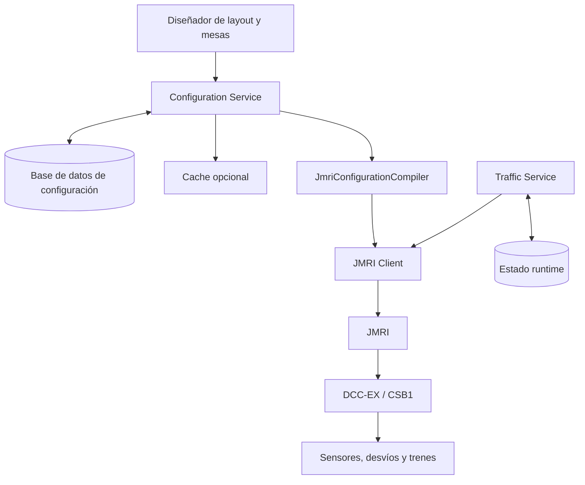
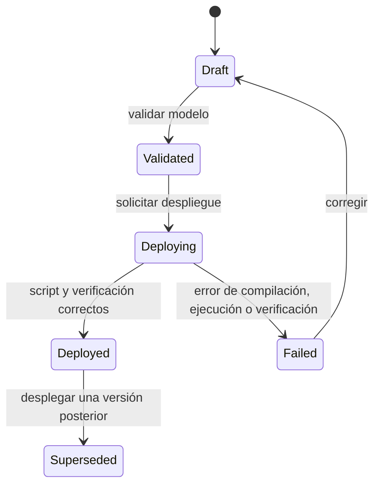

# Arquitectura — Configuración y operación ferroviaria con JMRI

**Estado:** propuesta inicial  
**Contexto:** restaurante con trenes a escala G, DCC-EX/CSB1 y JMRI  
**Propósito:** que el diseño del circuito sea configurable desde una aplicación propia y que la operación diaria sea segura, observable y separada de esa configuración.

## 1. Decisión principal

Separar el sistema en dos capacidades independientes:

| Capacidad | Pregunta que responde | Responsabilidad |
|---|---|---|
| **Configuration Service** | ¿Cómo está construida la red? | Layouts, mesas, bloques, sensores, desvíos, topología, versiones y despliegue a JMRI. |
| **Traffic Service** | ¿Qué está pasando ahora y qué puede hacer cada tren? | Ocupación, reservas, rutas activas, cambios de desvíos y movimientos. |

JMRI queda como la capa de integración y automatización ferroviaria. No es la fuente de verdad del layout ni el lugar para guardar reglas propias de negocio.



## 2. Límites de responsabilidad

### 2.1 Configuration Service

Es dueño de la definición versionada del circuito. Expone una API para crear y modificar:

- Layouts y sus versiones.
- Mesas y su asociación a bloques de llegada/salida.
- Blocks (tramos lógicos), sensores y turnouts.
- Conexiones entre blocks (`Path`) y posiciones requeridas de cada turnout (`BeanSetting`).
- Metadatos físicos: dirección DCC, tipo de sensor, feedback, zona, longitud aproximada y sentido permitido.

También valida, compila y despliega la configuración seleccionada a JMRI.

No decide si un tren puede entrar ahora a un tramo: esa decisión pertenece a Traffic Service.

### 2.2 Traffic Service

Es dueño del estado operativo, que cambia continuamente:

- Estado de sensores y ocupación estimada de cada block.
- Reservas temporales de bloques para evitar colisiones.
- Ruta planificada y ruta activa de cada tren.
- Órdenes de movimiento: arrancar, detener, velocidad, dirección y cambio de desvío.
- Reacción a errores: un sensor no cambia, una ruta queda ocupada, pérdida de conexión o parada de emergencia.

Consume la topología desplegada desde Configuration Service y los eventos/estados de JMRI. Debe persistir estado mínimo recuperable, pero puede mantener proyecciones de baja latencia en memoria o Redis.

### 2.3 JMRI

JMRI administra los objetos ferroviarios y se comunica con DCC-EX. Mantiene configuración en memoria y normalmente la persiste mediante archivos XML de su perfil; no reemplaza la base de datos de nuestra aplicación.

JMRI puede conocer un objeto como `IT1`, pero eso no demuestra por sí solo que haya hardware físico funcionando en esa dirección DCC. Por eso hay tres validaciones separadas.

## 3. Niveles de validación

| Nivel | Ejemplos | Cuándo |
|---|---|---|
| **Modelo** | IDs únicos, blocks existentes, conexiones válidas, requisitos de turnout no contradictorios, mesa alcanzable desde cocina. | Al guardar o validar un borrador. |
| **JMRI** | JMRI puede crear/encontrar `IB1`, `IS1`, `IT1`; el script se ejecuta sin error. | Antes y después de desplegar. |
| **Físico** | El sensor cambia `ACTIVE/INACTIVE`, el desvío entrega feedback, CSB1 está conectado, una locomotora responde. | Comisionamiento, arranque y supervisión operativa. |

Un `Block` es lógico: el decoder no sabe que existe. Para confirmar físicamente un desvío hacen falta sensores de feedback o un mecanismo equivalente; una orden aceptada no siempre significa que el desvío se movió.

## 4. Modelo de dominio mínimo

El modelo propio no depende de JMRI ni de Python.

```text
RailwayLayout
 ├─ LayoutVersion
 ├─ Table
 ├─ Block
 │   └─ SensorBinding
 ├─ Sensor
 ├─ Turnout
 └─ Connection
     ├─ FromBlock
     ├─ ToBlock
     ├─ Directionality
     └─ TurnoutRequirements
```

Ejemplo conceptual:

```text
Cocina ─ B1 ─ T1 ─ B2 ─ Mesa 5
                  └ B3 ─ Mesa 12

B1 ↔ B2: T1 = CLOSED
B1 ↔ B3: T1 = THROWN
```

La base de datos guarda ese modelo y sus versiones. El adaptador JMRI lo traduce a `Block`, `Path` y `BeanSetting`.

## 5. Flujo de vida de una versión



Una versión desplegada no debe cambiarse en sitio. Se crea una nueva versión en borrador, se valida y solo entonces se despliega. Así el restaurante puede seguir operando mientras se diseña una modificación.

## 6. Flujo de despliegue a JMRI

1. La UI envía o modifica una versión `Draft`.
2. Configuration Service valida la topología y guarda el resultado en la base de datos.
3. Se solicita el despliegue explícitamente.
4. `JmriConfigurationCompiler` transforma el modelo neutral en Jython determinístico.
5. `IJmriConfigurationClient` entrega el script a JMRI y obtiene el resultado.
6. Se verifica que los objetos y paths requeridos estén disponibles en JMRI.
7. La versión queda `Deployed` o `Failed`, con registro del script, fecha, resultado y errores.
8. Configuration Service publica el identificador de la topología desplegada para Traffic Service.

No se debe considerar el guardado en base de datos y el despliegue como una única transacción: JMRI es un sistema externo. El despliegue es un proceso con estado, reintentos controlados e historial.

## 7. Paquetes y adaptadores .NET

Propuesta de soluciones/proyectos:

```text
Railway.Core
  - Modelo ferroviario neutral y validadores de dominio.

Railway.Jmri.Configuration
  - JmriConfigurationCompiler.
  - Generador Jython: Blocks, Sensors, Turnouts, Paths y BeanSettings.
  - Validación específica de capacidades JMRI.

Railway.Jmri.Client
  - Cliente de configuración y ejecución contra JMRI.
  - Consultas de objetos, estados y suscripción de eventos.

Railway.ConfigurationService
  - API, persistencia, versionado y orquestación de despliegue.

Railway.TrafficService
  - Reservas, cálculo de rutas, control de movimiento y seguridad runtime.
```

`Railway.Core` no conoce JMRI. Por eso en el futuro podría añadirse un compilador para otro sistema sin rediseñar el editor ni la topología.

## 8. Interfaces clave

```csharp
public interface IRailwayLayoutValidator
{
    ValidationResult Validate(RailwayLayout layout);
}

public interface IJmriConfigurationCompiler
{
    JmriCompilationResult Compile(RailwayLayout layout);
}

public interface IJmriConfigurationClient
{
    Task<JmriExecutionResult> ExecuteAsync(
        JmriScript script,
        CancellationToken cancellationToken);
}

public interface IJmriRuntimeClient
{
    Task<SensorState> GetSensorStateAsync(string systemName);
    Task SetTurnoutAsync(string systemName, TurnoutPosition position);
    IAsyncEnumerable<RailwayEvent> SubscribeAsync(
        CancellationToken cancellationToken);
}
```

Separar `IJmriConfigurationClient` de `IJmriRuntimeClient` evita que la API de despliegue termine mezclada con control de trenes en tiempo real.

## 9. Persistencia y caché

La base de datos es la fuente de verdad. MongoDB encaja bien si se desea guardar cada layout como documento versionado; PostgreSQL encaja igualmente si se prefieren relaciones y consultas administrativas. La decisión no debe basarse solamente en velocidad.

La cache es opcional y se usa para acelerar lecturas de la versión desplegada y de la topología usada por Traffic Service. Puede ser memoria local al comienzo y Redis cuando haya más de una instancia. Una caída de cache no debe hacer perder configuraciones ni reservas críticas.

Datos que conviene persistir:

- Versiones de layout, autor, fecha, estado y checksum.
- Script Jython generado y resultado de su ejecución.
- Mapeo de mesas con blocks.
- Catálogo de direcciones DCC y tipo de hardware.
- Auditoría de despliegues y rollback.
- Eventos y fallos relevantes de operación.

## 10. APIs iniciales

```text
POST /layouts
POST /layouts/{layoutId}/versions
GET  /layouts/{layoutId}/versions/{version}
POST /layouts/{layoutId}/versions/{version}/validate
POST /layouts/{layoutId}/versions/{version}/deploy
GET  /layouts/{layoutId}/deployment

GET  /runtime/layout
GET  /runtime/blocks
POST /runtime/routes/reservations
POST /runtime/turnouts/{id}/position
POST /runtime/trains/{id}/stop
```

Las operaciones de despliegue deben ser idempotentes mediante una clave de operación o un identificador de solicitud, para que un reintento no ejecute dos veces una misma configuración.

## 11. Seguridad y operación

- Un despliegue se permite solo cuando la operación esté detenida o en modo mantenimiento, salvo que se pruebe con rigor que el cambio es inocuo.
- Traffic Service debe tener parada de emergencia independiente del flujo normal de pedidos.
- Una ruta se reserva antes de ordenar movimiento y se libera únicamente con evidencia de sensores o tras una recuperación controlada.
- Registrar siempre `orden enviada`, `estado conocido`, `feedback físico` y `timeout`; no asumir que son iguales.
- Mantener una versión anterior desplegable para rollback.

## 12. Alcance del primer MVP

El primer MVP debe limitarse a:

1. Diseñar/guardar un layout versionado.
2. Declarar blocks, sensores, turnouts y conexiones bidireccionales.
3. Validar coherencia del modelo.
4. Generar un script Jython revisable.
5. Desplegar a JMRI y guardar el resultado.
6. Leer cambios de sensores y mostrar ocupación por block.
7. Reservar manualmente una ruta simple Cocina → Mesa y mover un solo tren de prueba.

Se deja para una etapa posterior: varios trenes simultáneos, optimización de rutas, recuperación automática, pedidos de restaurante, desacople automático, RFID y planificación avanzada.

## 13. Decisiones pendientes

- Definir el mecanismo concreto de integración JMRI ↔ .NET: HTTP, WebSocket, MQTT, script launcher o un puente propio.
- Elegir MongoDB o PostgreSQL según el patrón de consulta y operación administrativa esperado.
- Definir sensores de feedback para cada desvío crítico.
- Definir cómo JMRI carga/aplica una nueva configuración sin dejar objetos sobrantes de una versión anterior.
- Especificar las reglas de reserva, timeout, liberación y parada segura.
- Decidir si JMRI será solo adaptador de hardware o también participará en lógica de rutas/automatización.

