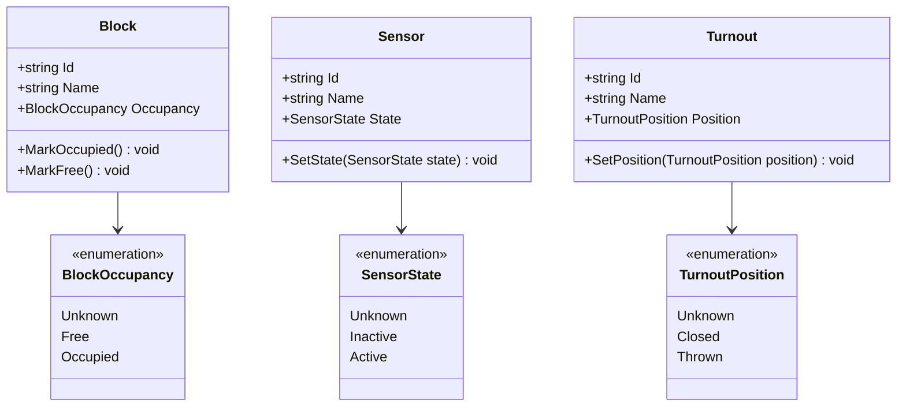

# Modelo de Dominio Ferroviario (Railway Core Domain)

Este documento describe el modelo de dominio neutral ubicado en `Railway.Core.Domain`. Representa los conceptos centrales de la infraestructura ferroviaria del restaurante, completamente desacoplados de protocolos de comunicación, librerías de terceros, JMRI y hardware físico (ESP32, PCA9685, etc.), en cumplimiento con **ADR-005**.

---

## 1. Principios del Modelo

1. **Neutralidad Tecnológica:** El dominio no conoce detalles de transporte (WebSocket, MQTT, HTTP), ni estructuras propietarias de JMRI o microcontroladores.
2. **Encapsulamiento de Estado:** Los cambios de estado no se realizan mediante mutación pública descontrolada; se ejecutan a través de métodos explícitos de negocio (`MarkOccupied()`, `SetPosition()`, `SetState()`).
3. **Identificadores Estables:** Cada entidad posee un identificador inmutable (`Id`) que corresponde al estándar acordado para el trazado (ej. `B1`, `IS1`, `T1`).
4. **Estado Inicial Seguro (`Unknown`):** Al instanciar cualquier elemento, su estado inicial es `Unknown` hasta que una fuente autorizada (simulación o telemetría real) confirme su condición.

---

## 2. Diagrama de Clases

---

## 3. Entidades Iniciales

### 3.1 `Block` (Bloque de Vía)
Representa una sección física o lógica de la vía ferrovial delimitada. Es la unidad básica utilizada para la detección de ocupación, prevención de colisiones y reservas de trayectos.

- **Propiedades:**
  - `Id` (`string`): Identificador único (ejemplo: `"B1"`, `"B2"`).
  - `Name` (`string`): Nombre descriptivo o área asociada (ejemplo: `"Bloque Entrada Estación"`).
  - `Occupancy` (`BlockOccupancy`): Estado actual de ocupación.
- **Transiciones (`BlockOccupancy`):**
  - `Unknown`: Estado inicial de arranque antes de recibir telemetría.
  - `Free`: La vía está despejada y apta para ser reservada o transitada.
  - `Occupied`: Hay un tren o material rodante presente en el tramo.
- **Comportamiento:**
  - `MarkOccupied()`: Cambia el estado a `Occupied`.
  - `MarkFree()`: Cambia el estado a `Free`.

---

### 3.2 `Sensor` (Sensor de Detección)
Representa un dispositivo puntual de detección en vía (sensores de efecto Hall, reed switches magnéticos, barreras ópticas o sensores simulados).

- **Propiedades:**
  - `Id` (`string`): Identificador del sensor en el layout (ejemplo: `"IS1"`).
  - `Name` (`string`): Nombre o descripción de ubicación (ejemplo: `"Sensor Entrada B1"`).
  - `State` (`SensorState`): Condición de lectura del sensor.
- **Transiciones (`SensorState`):**
  - `Unknown`: Sin lectura inicial confirmada.
  - `Inactive`: Sensor despejado (sin detección de imán o presencia).
  - `Active`: Sensor activado por el paso de un tren.
- **Comportamiento:**
  - `SetState(SensorState state)`: Actualiza la lectura tras un evento.

---

### 3.3 `Turnout` (Desvío / Cambio de Aguja)
Representa un aparato de vía motorizado (servoaccionado o bobina) que bifurca el trazado hacia dos rutas posibles.

- **Propiedades:**
  - `Id` (`string`): Identificador del desvío (ejemplo: `"T1"`).
  - `Name` (`string`): Nombre descriptivo (ejemplo: `"Desvío Principal"`).
  - `Position` (`TurnoutPosition`): Posición mecánica actual.
- **Transiciones (`TurnoutPosition`):**
  - `Unknown`: Posición no confirmada al inicio.
  - `Closed`: Posición directa o vía principal (recto).
  - `Thrown`: Posición desviada hacia la ruta alternativa o apartadero.
- **Comportamiento:**
  - `SetPosition(TurnoutPosition position)`: Modifica la posición registrada tras orden o confirmación.

---

## 4. Próxima Evolución del Modelo

A medida que se desarrollen las siguientes historias del backlog, el modelo se ampliará con:

1. **`Path` y `BeanSetting`:** Conexiones direccionales entre bloques con restricciones de posición de desvíos requeridas.
2. **`Train` / `RollingStock`:** Identificación, velocidad y dirección de los trenes en circulación (DCC y a batería).
3. **Eventos de Dominio:** Notificaciones internas ante cambios de ocupación (`BlockOccupiedEvent`, `SensorTriggeredEvent`, `TurnoutAlignedEvent`).
4. **Mapeadores de Integración (`Railway.Jmri.Client`):** Traductores que convertirán mensajes JSON de JMRI WebSocket a invocaciones de este dominio neutral.
